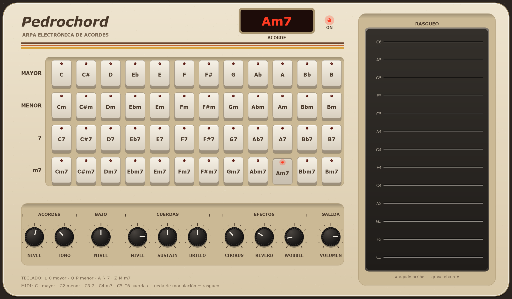

<div align="center">

# Pedrochord

**Un instrumento electrónico estilo omnichord en formato VST3: mantenés un botón de acorde, rasgueás la franja y cada cuerda toca una nota de ese acorde.**

[English](README.md) · **Español**

[](https://github.com/pedrofelipe14/pedrochord/actions/workflows/build.yml)




</div>

## Cómo se toca

- **Botones de acorde:** 12 tonalidades × 4 tipos (mayor, menor, 7 y m7). Mientras mantenés uno, suena su acorde como un colchón suave tipo órgano, con la fundamental en el bajo. Deslizá hasta otro botón para cambiar de acorde; si lo soltás, vuelve el que tenías apretado antes.
- **Franja de rasgueo:** 13 cuerdas, la más grave abajo. Tocá una para pulsarla o arrastrá sobre varias para rasguear; cuanto más rápido, más fuerte. Cada cuerda toca la siguiente nota del acorde, así que todo rasgueo suena afinado. Las cuerdas se quedan con el último acorde aunque sueltes el botón.
- **Sonido:** las cuerdas son una voz FM de dos operadores cuyo brillo se apaga antes que el cuerpo: arrancan cristalinas y se van apagando suaves. Hay controles de niveles, sustain y brillo de las cuerdas, chorus, reverb y *wobble*, una desafinación lenta tipo cinta.

### Desde un DAW (MIDI)

| Notas | Toca |
|---|---|
| C1–B1 | Acorde mayor en esa tonalidad |
| C2–B2 | Menor |
| C3–B3 | Séptima |
| C4–B4 | Menor séptima |
| C5–C6 | Cuerdas 1 a 13 |
| CC1 (rueda de modulación) | Recorre las cuerdas como un dedo sobre la franja |

## Cómo está hecho

```
dsp/      el instrumento: C++17 header-only, sin JUCE (también va a compilar a WebAssembly)
  include/pedrochord/chords.h    acordes, voicings y el mapeo MIDI
  include/pedrochord/voices.h    voces de colchón, bajo y cuerdas FM
  include/pedrochord/effects.h   chorus y una reverb chica estilo Freeverb
  include/pedrochord/engine.h    pila de acordes apretados, lógica de rasgueo y mezcla
  tests/                       16 tests nativos
plugin/   la capa JUCE y el editor, dibujado como hardware de los 80 (cuerpo crema, display de LEDs, placa ranurada)
tools/    un renderizador fuera de pantalla que saca la captura de arriba
```

- **La interfaz también toca por MIDI.** Los botones y la franja mandan los mismos mensajes de nota que mandaría un DAW, por una cola segura entre hilos. Así, mouse, touch y MIDI comparten un solo camino de código, y los tests lo cubren.
- **Precisión de muestra.** El procesador renderiza hasta cada evento MIDI y recién ahí lo aplica, así que un rasgueo mantiene su tiempo dentro de un bloque.
- **Nada reserva memoria en el hilo de audio.** Las líneas de delay son arrays de tamaño fijo, y la interfaz lee el estado del motor (acorde apretado, brillo de cada cuerda) desde atomics.
- **Validado como lo cargaría un DAW:** el CI corre [pluginval](https://github.com/Tracktion/pluginval) en su nivel más estricto (10) en cada push: distintos sample rates y tamaños de bloque, guardar y restaurar estado, automatización, valores aleatorios en los parámetros y abrir el editor mientras procesa audio.
- **Testeado sin DAW:** los voicings, el mapeo MIDI, la pila de acordes, que un rasgueo pulse las cuerdas correctas, que el decay no dependa del sample rate, y una prueba de estrés con todo al máximo que no da valores inválidos ni llega a saturar.

## Compilar

Hace falta CMake 3.22+ y Visual Studio 2022 (u otro compilador C++17). JUCE es un submódulo.

```sh
git clone --recursive https://github.com/pedrofelipe14/pedrochord.git
cmake -B build
cmake --build build --config Release --target Pedrochord_All
# Solo los tests del DSP:
cmake -S dsp -B dsp/build && cmake --build dsp/build --config Release && dsp/build/Release/dsp_tests
```

## Próximos pasos

- [ ] Sección rítmica: patrones de batería con un bajo automático que sigue al acorde.
- [x] Tocar con el teclado de la compu: 1-0 mayor, Q-P menor, A-Ñ 7, Z-M m7 (teclado latinoamericano).
- [ ] La versión web: el mismo `dsp/` compilado a WebAssembly, para tocar desde el celular.
