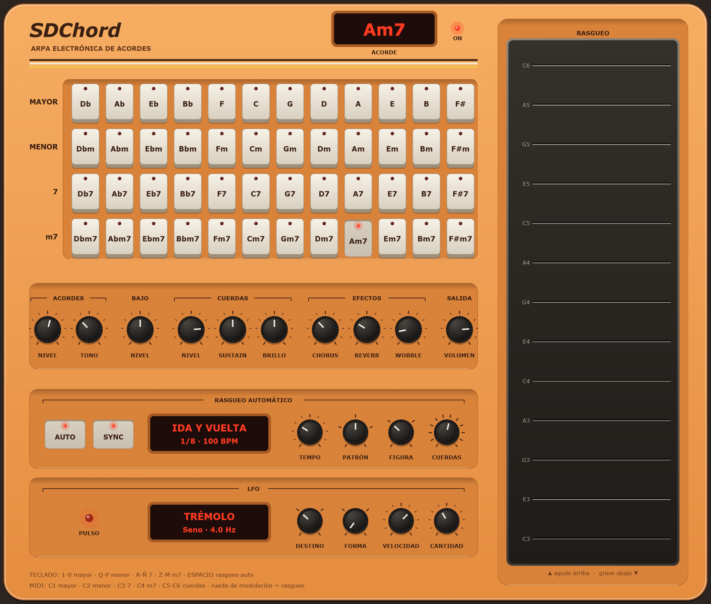

<div align="center">

# Pedrochord

**An omnichord-style electronic instrument as a VST3 plugin: hold a chord button, strum the plate, and every string plays a note of that chord.**

**English** · [Español](README.es.md)

[](https://github.com/pedrofelipe14/pedrochord/actions/workflows/build.yml)




**▶ [Play it in your browser](https://pedrofelipe14.github.io/pedrochord/)**: the same C++ engine compiled to WebAssembly, on desktop or phone.

</div>

## How it plays

- **Chord buttons:** 12 roots × 4 chord types (major, minor, 7, m7). While you hold one, its chord sounds as a soft organ-like pad with the root in the bass. Slide onto another button to change chords; let go and the previous held chord comes back.
- **Strum plate:** 13 strings, lowest at the bottom. Touch a string to pluck it or drag across them to strum; faster strums play louder. Each string plays the next tone of the current chord, so every strum is in tune. The strings keep the last chord after you let go of its button.
- **Sound:** strings are a two-operator FM voice whose brightness fades faster than its body, so they start glassy and ring out mellow. Controls cover levels, string sustain and brightness, chorus, reverb and *wobble*, a tape-like pitch drift.

- **Auto-strum:** a sequencer that plays the strings by itself, in time, while you hold a chord. It has five patterns (up, down, up and down, full strum alternating down and up strokes, random), quarter to sixteenth-note steps including triplets, and a range that sets how many strings it uses. The first step of each beat is accented. It follows the DAW's tempo with SYNC on. Space switches it on and off.

- **Rhythm machine (web version):** eight preset one-bar rhythms in the style of the old preset rhythm boxes (rock, disco, ballad, bossa nova, cumbia, rumba, waltz, swing). Every drum is synthesised, with no samples: kick, snare, rim, open and closed hats, two congas and a cowbell. It shares the tempo with the auto-strum, and while it runs it is the clock, so the strums lock to its grid. Enter starts and stops it.

### Computer keyboard

`1`–`0` major · `Q`–`P` minor · `A`–`Ñ` seventh · `Z`–`M` minor seventh (from C, left to right, Latin American layout) · space: auto-strum · enter: rhythm machine (web).

### From a DAW (MIDI)

| Notes | Plays |
|---|---|
| C1–B1 | Major chord on that root |
| C2–B2 | Minor |
| C3–B3 | Seventh |
| C4–B4 | Minor seventh |
| C5–C6 | Strings 1–13 |
| CC1 (mod wheel) | Sweeps across the strings like a finger on the plate |

## How it's built

```
dsp/      the instrument: header-only C++17, no JUCE, so the plugin and the web share it
  include/pedrochord/chords.h    chords, voicings, the MIDI layout
  include/pedrochord/voices.h    pad, bass and FM string voices
  include/pedrochord/effects.h   chorus and a small Freeverb-style reverb
  include/pedrochord/engine.h    held-chord stack, strum logic, the auto-strum sequencer, the shared clock, mixing
  include/pedrochord/rhythm.h    the rhythm machine: synthesised drum voices and the preset patterns
  tests/                       28 native tests
plugin/   JUCE wrapper and the editor, drawn as 1980s hardware (orange body, LED readout, ribbed plate)
tools/    an off-screen renderer that takes the screenshot above
dsp/src/wasm_api.cpp + scripts/build-wasm.sh   a C API over the engine, built into a 23 KB .wasm with no JS glue
web/      the browser version: React + TypeScript, the engine in an AudioWorklet
```

- **The UI plays through MIDI too.** Chord buttons and the strum plate send the same note messages a DAW would, through a thread-safe queue. So mouse, touch and MIDI share a single code path, and the tests exercise it.
- **Sample-accurate.** The processor renders up to each MIDI event and then applies it, so a strum keeps its timing inside a block.
- **Nothing allocates on the audio thread.** Delay lines are fixed-size arrays, and the UI reads the engine's state (held chord, string glow) from atomics.
- **Validated like a DAW would load it:** CI runs [pluginval](https://github.com/Tracktion/pluginval) at its strictest level (10) on every push: different sample rates and block sizes, state save and restore, automation, parameter fuzzing, and opening the editor while audio runs.
- **One engine, two homes.** The browser runs the very same `dsp/` code: the AudioWorklet instantiates the .wasm directly, sends notes and parameters as messages, and gets back the held chord and each string's level to draw. The page has multi-touch chord keys you can slide across, a strum plate that turns sideways on phones, the computer keyboard by physical key position (any layout), and Web MIDI controllers. Its 14 tests include the compiled engine itself, and a check that the parameter ids match the C++.
- **Tested without a DAW:** the auto-strum's timing at every step length and the order of every pattern, chord voicings, the MIDI layout, the held-chord stack, strums crossing the right strings, decay times that don't depend on the sample rate, and a stress test with everything at maximum that stays finite and below full scale.

## Building

Needs CMake 3.22+ and Visual Studio 2022 (or another C++17 compiler). JUCE is a submodule.

```sh
git clone --recursive https://github.com/pedrofelipe14/pedrochord.git
cmake -B build
cmake --build build --config Release --target Pedrochord_All
# Web version (needs Emscripten and Node):
./scripts/build-wasm.sh && cd web && npm install && npm run dev
# DSP tests only:
cmake -S dsp -B dsp/build && cmake --build dsp/build --config Release && dsp/build/Release/dsp_tests
```

## Roadmap

- [x] Auto-strum sequencer.
- [x] A rhythm machine with preset patterns, locked to the auto-strum (web version).
- [ ] An auto-bass that follows the chord in time with the drums.
- [x] Computer-keyboard play: 1-0 major, Q-P minor, A-Ñ 7, Z-M m7 (Latin American layout).
- [x] The web version: the same `dsp/` compiled to WebAssembly, playable on a phone.
